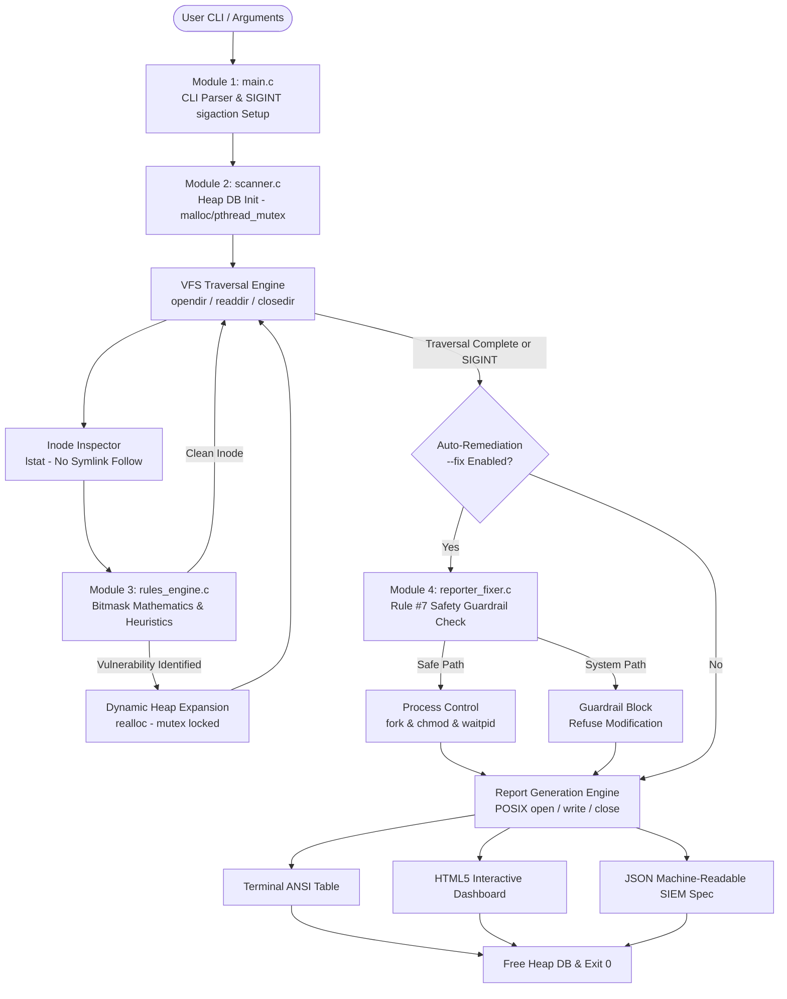

# Academic Project Report: Linux File Permission Analyzer (LfPA)

**Course Code:** 25CS2104E  
**Course Title:** Operating Systems and Systems Programming (OSSP)  
**Academic Year:** 2025–2026  
**Document Classification:** Formal Technical Specification & Laboratory Evaluation Report  

---

## Executive Abstract

In POSIX-compliant multi-user operating systems, the Discretionary Access Control (DAC) model governs access to filesystem inodes via 12 permission bits divided into owner, group, and others triads, alongside special execution flags (Set-UID, Set-GID, and the Sticky Bit). Misconfigurations in these bitmasks—such as world-writable sensitive scripts, unmonitored SUID root binaries, exposed cryptographic keys, and shared directories lacking the sticky bit—represent the primary vector for local privilege escalation (LPE), unauthorized data manipulation, and credential compromise.

The **Linux File Permission Analyzer (LfPA)** is an industrial-grade systems utility developed in standard C11 to perform deterministic, recursive Virtual File System (VFS) traversal, deep inode metadata inspection, bitmask-level vulnerability detection, and child process-isolated auto-remediation. By strictly avoiding library-level abstractions and directly interfacing with the Linux kernel through POSIX system calls (`lstat`, `open`, `write`, `close`, `chmod`, `fork`, `waitpid`, and `sigaction`), the tool serves as a pedagogical reference and defensive audit engine. This project directly validates Course Outcomes **CO1 through CO6** of the 25CS2104E syllabus while strictly complying with Rule #7 sandbox safety guardrails.

---

## 1. Syllabus & Course Outcome (CO) Mapping Matrix

| Course Outcome | Theoretical Concept | Concrete Implementation in LfPA | Primary File & Functions |
|---|---|---|---|
| **CO1: System Calls & OS Protection** | POSIX system call interface, user/kernel space transitions, low-level file I/O, error management via `errno`/`perror`. | Direct invocation of `lstat()`, `open()`, `write()`, `close()`, and `chmod()`. Low-level atomic write loops for JSON/HTML report generation without stdio buffering. | [`src/reporter_fixer.c`](file:///c:/Users/Acer/OneDrive/Desktop/LfPA/src/reporter_fixer.c): `export_json_report()`, `export_html_report()`, `write_all_fd()` |
| **CO2: Process Control** | Process lifecycle management, address space duplication (`fork`), child isolation, parent synchronization via `waitpid()`. | Auto-remediation engine spawns a dedicated child process per vulnerable inode to safely execute `chmod()`, preventing parent process memory corruption or crash propagation. | [`src/reporter_fixer.c`](file:///c:/Users/Acer/OneDrive/Desktop/LfPA/src/reporter_fixer.c): `remediate_single_record()` |
| **CO3: Signals & IPC** | Asynchronous signal interception, signal masks, reentrancy, async-signal-safe I/O via POSIX `sigaction()`. | Signal handler catching `SIGINT` (`Ctrl+C`) with `sa_mask` initialization; sets `volatile sig_atomic_t g_stop_requested` and flushes all gathered findings safely. | [`src/main.c`](file:///c:/Users/Acer/OneDrive/Desktop/LfPA/src/main.c): `setup_signal_handlers()`, `handle_sigint()` |
| **CO4: Dynamic Memory Management** | Heap allocation, geometric reallocation amortized O(1) growth, memory leak prevention, Valgrind verification. | Dynamic array `AuditDB` managing heap-allocated `AuditRecord` entries via `malloc()`, `realloc()` capacity doubling, and zero-leak cleanup in `audit_db_free()`. | [`src/scanner.c`](file:///c:/Users/Acer/OneDrive/Desktop/LfPA/src/scanner.c): `audit_db_init()`, `audit_db_add()`, `audit_db_free()` |
| **CO5: VFS & Inode Abstractions** | VFS hierarchical directory traversal, inode attribute retrieval without dereferencing symlinks, user/group database lookups. | Recursive directory traversal using `opendir()`, `readdir()`, `closedir()`; inode inspection via `lstat()`; identity resolution via `getpwuid()` and `getgrgid()`. | [`src/scanner.c`](file:///c:/Users/Acer/OneDrive/Desktop/LfPA/src/scanner.c): `scan_directory_recursive()`, `scan_file_or_dir()`, `resolve_identity()` |
| **CO6: Concurrency & Synchronization** | Thread safety, race condition prevention, POSIX mutual exclusion primitives. | All insertions into `AuditDB` and mutation of global scan telemetry counters are synchronized using `pthread_mutex_t` (`pthread_mutex_lock` / `unlock`). | [`src/scanner.c`](file:///c:/Users/Acer/OneDrive/Desktop/LfPA/src/scanner.c): `audit_db_add()`, `db->lock` |

---

## 2. High-Level Architectural Design

The LfPA architecture is designed as a pipeline of four decoupled modules. The workflow controller orchestrates execution between VFS scanning, bitmask security analysis, child-isolated remediation, and low-level report emission.



---

## 3. Detailed Virtual File System (VFS) & Inode Mechanics

### 3.1 The Role of `lstat()` vs `stat()`
In Linux systems programming, the distinction between `stat()` and `lstat()` is critical for security:
- `stat()` resolves symbolic links recursively until the target inode is reached. If an adversary introduces a circular symlink structure (`linkA -> linkB -> linkA`) or points a symlink to `/dev/zero` or `/proc/kcore`, a naive analyzer calling `stat()` will enter infinite loops, exhaust file descriptors, or dereference sensitive target files erroneously.
- `lstat()` reads the metadata of the symbolic link inode itself without following the link pointer (`st_mode & S_IFMT == S_IFLNK`). 

LfPA strictly leverages `lstat()`. When `S_ISLNK(st.st_mode)` evaluates to true, the engine increments `db->total_symlinks_skipped`, logs the event in verbose mode, and skips recursive traversal, thereby neutralizing symlink race conditions and denial-of-service loops.

### 3.2 Inode Attributes Collected
For every inspected inode, LfPA extracts and caches the following attributes inside `AuditRecord`:
```c
typedef struct {
    char path[1024];               // Canonical or relative path
    mode_t raw_mode;               // Raw st_mode bitfield (file type + permissions)
    char perm_str[11];             // 10-char string representation (-rwxrwxrwx)
    uid_t uid;                     // Inode owner user ID
    gid_t gid;                     // Inode group ID
    char owner_name[64];           // getpwuid() resolved name
    char group_name[64];           // getgrgid() resolved name
    ino_t inode_num;               // 64-bit unique VFS inode identifier
    off_t size_bytes;              // File size in bytes (st_size)
    time_t mtime;                  // Timestamp of last content modification
    FindingType finding_type;      // Categorized vulnerability
    SeverityLevel severity;        // Risk rating (CRITICAL, HIGH, MEDIUM, LOW)
    char rule_id[16];              // Rule identifier (e.g., SEC-001)
    char description[256];         // Technical finding rationale
    mode_t recommended_mode;       // Mathematically sanitized target mode
    bool is_fixed;                 // True if child process successfully remediated
    char fix_status[128];          // Execution status message
} AuditRecord;
```

---

## 4. Mathematical Foundation of Permission Bitmasks

In POSIX architectures, file permissions are stored within a 16-bit integer field `mode_t` inside `struct stat`. The lowest 12 bits define Discretionary Access Control rights:

```text
 15 14 13 12 | 11 10  9 |  8  7  6 |  5  4  3 |  2  1  0
[ File Type ] | [Special] | [ User  ] | [ Group ] | [ Others]
               |  u  g  t |  r  w  x |  r  w  x |  r  w  x
```

### 4.1 Bitmask Definitions and Octal Constants
- **User Read/Write/Execute:** `S_IRWXU = 0700` (`S_IRUSR = 0400`, `S_IWUSR = 0200`, `S_IXUSR = 0100`)
- **Group Read/Write/Execute:** `S_IRWXG = 0070` (`S_IRGRP = 0040`, `S_IWGRP = 0020`, `S_IXGRP = 0010`)
- **Others Read/Write/Execute:** `S_IRWXO = 0007` (`S_IROTH = 0004`, `S_IWOTH = 0002`, `S_IXOTH = 0001`)
- **Special Bits:**
  - `S_ISUID = 04000` (Set User ID upon execution)
  - `S_ISGID = 02000` (Set Group ID upon execution)
  - `S_ISVTX = 01000` (Sticky Bit / Restricted deletion flag)

### 4.2 Security Evaluation Mathematical Truth Tables

#### Rule SEC-001: World-Writable Executables
$$\text{Violation} = (\text{st\_mode} \ \& \ \text{S\_IWOTH}) \neq 0 \ \land \ (\text{st\_mode} \ \& \ (\text{S\_IXUSR} \lor \text{S\_IXGRP} \lor \text{S\_IXOTH}) \neq 0)$$
- **Threat:** Any unprivileged user on the operating system can inject arbitrary code into an executable script or binary executed by administrators or daemons.
- **Remediation Equation:**
$$\text{mode}_{\text{remediated}} = \text{mode}_{\text{current}} \ \& \ \sim(\text{S\_IWGRP} \lor \text{S\_IWOTH})$$

#### Rule SEC-002: Set-UID (SUID) Binary Execution
$$\text{Violation} = (\text{st\_mode} \ \& \ \text{S\_ISUID}) \neq 0 \ \land \ \text{S\_ISREG}(\text{st\_mode}) \ \land \ (\text{st\_mode} \ \& \ 0111 \neq 0)$$
- **Threat:** The executable process executes with the effective UID of the file owner. If the owner is root (UID 0), any vulnerability or logic bug allows instant root privilege escalation.
- **Remediation Equation:**
$$\text{mode}_{\text{remediated}} = \text{mode}_{\text{current}} \ \& \ \sim\text{S\_ISUID}$$

#### Rule SEC-004: World-Writable Directory Missing Sticky Bit
$$\text{Violation} = \text{S\_ISDIR}(\text{st\_mode}) \ \land \ (\text{st\_mode} \ \& \ \text{S\_IWOTH}) \neq 0 \ \land \ (\text{st\_mode} \ \& \ \text{S\_ISVTX}) = 0$$
- **Threat:** In POSIX directories without the sticky bit, any user with write access can `unlink()` (delete) or rename files owned by *other users*. This enables denial-of-service, symlink replacement attacks, and temporary file race conditions (TOCTOU).
- **Remediation Equation:**
$$\text{mode}_{\text{remediated}} = \text{mode}_{\text{current}} \ | \ \text{S\_ISVTX} \quad (\text{e.g., } 0777 \rightarrow 01777)$$

#### Rule SEC-005: Sensitive Cryptographic Secrets & Credentials
- **Criteria:** Filename matches `id_rsa`, `id_ed25519`, `.env`, `credentials.json`, `master.key`, or `*.pem`.
- **Condition:** $(\text{st\_mode} \ \& \ 0077) \neq 0$ (Group or World readable/writable).
- **Threat:** Private keys and environmental credentials accessible to other local users or compromised service accounts.
- **Remediation Equation:**
$$\text{mode}_{\text{remediated}} = \text{S\_IRUSR} \lor \text{S\_IWUSR} \quad (0600 \text{ octal})$$

---

## 5. Process Control & Isolated Auto-Remediation (CO2)

### 5.1 The Threat of In-Process Direct Mutation
Calling `chmod()` directly from the main scanning thread introduces architectural risks:
1. If modifying permissions on an NFS or FUSE filesystem that hangs or encounters I/O Deadlocks, the entire scanning tool hangs indefinitely.
2. If `chmod()` triggers kernel faults or permission errors that alter process state, the main audit database can be corrupted.
3. Testing permission changes under privilege boundaries is unisolated.

### 5.2 Process Lifecycle Implementation
LfPA implements a secure, isolated worker process pattern using `fork()`, `chmod()`, and `waitpid()`:

```mermaid
sequenceDiagram
    autonumber
    participant P as Parent Process (Scanner)
    participant K as Linux Kernel
    participant C as Isolated Child Process

    P->>P: Check is_safe_path() guardrail
    P->>P: fflush(stdout); fflush(stderr);
    P->>K: fork() System Call
    K-->>P: Returns Child PID (> 0)
    K-->>C: Returns 0 in Child Space
    Note over C: Isolated Address Space
    C->>K: chmod(record->path, sanitized_mode)
    alt chmod Succeeds
        C->>K: _exit(EXIT_SUCCESS)
    else chmod Fails (EPERM, EACCES)
        C->>K: _exit(EXIT_FAILURE)
    end
    P->>K: waitpid(child_pid, &status, 0)
    K-->>P: Child termination event & exit status
    P->>P: Evaluate WIFEXITED(status) && WEXITSTATUS(status)
    P->>P: Mark record->is_fixed = true & update telemetry
```

### 5.3 Stdio Buffer Duplication Prevention
When `fork()` is called, the child inherits duplicate copies of user-space stdio buffers. If `fflush(stdout)` is omitted, any unflushed data printed by the parent is duplicated and flushed a second time when the child exits. Furthermore, child processes must terminate using `_exit()` rather than `exit()` to prevent executing parent `atexit` callbacks or double-flushing stdio streams. LfPA explicitly incorporates these safeguards.

---

## 6. Rule #7 Compliance: Controlled Environment Safety Guardrail

The course rubric mandates that tools must not disrupt host system processes or other users. LfPA enforces **Defense-in-Depth Safety Guardrails**:

### 6.1 Two-Tier Protection Mechanism
1. **Tier 1 (CLI Target Rejection):** If a user passes `--fix` targeting system root directories (`/etc`, `/bin`, `/sbin`, `/usr`, `/lib`, `/sys`, `/proc`, `/dev`, `/boot`, `/root`), `main.c` immediately terminates with exit status 1 before starting any filesystem traversal.
2. **Tier 2 (Per-Inode Canonical Path Inspection):** During traversal, before any child process is forked for remediation, `is_safe_path()` resolves the canonical path using `realpath()`:
   ```c
   bool is_safe_path(const char *path) {
       if (!path || strlen(path) == 0 || strcmp(path, "/") == 0) return false;
       char resolved[MAX_PATH_LEN];
       if (realpath(path, resolved) == NULL) {
           strncpy(resolved, path, sizeof(resolved) - 1);
       }
       for (int i = 0; PROTECTED_SYSTEM_DIRS[i] != NULL; ++i) {
           size_t sys_len = strlen(PROTECTED_SYSTEM_DIRS[i]);
           if (strncmp(resolved, PROTECTED_SYSTEM_DIRS[i], sys_len) == 0) {
               if (resolved[sys_len] == '\0' || resolved[sys_len] == '/') {
                   return false; // Strictly blocked
               }
           }
       }
       return true;
   }
   ```
   This prevents directory traversal tricks (e.g., `./demo_sandbox/../../etc/shadow`).

### 6.2 Self-Contained Test Sandbox
The included `scripts/setup_sandbox.sh` script creates an isolated `./demo_sandbox` populated with eight representative vulnerability fixtures, enabling safe, live demonstrations without root privileges or system modifications.

---

## 7. Dynamic Memory Architecture & Zero-Leak Verification (CO4)

### 7.1 Geometric Growth Strategy
Rather than statically sizing audit records or reallocating on every individual finding (which incurs $O(N^2)$ copying overhead), `AuditDB` employs an amortized $O(1)$ doubling strategy:
- Initial capacity: `INITIAL_DB_CAP = 32` records.
- When `count == capacity`: `capacity = capacity * 2`.
- Memory expansion uses `realloc()` with temporary pointers to prevent dangling references on allocation failure:
  ```c
  AuditRecord *expanded = (AuditRecord *)realloc(db->records, new_cap * sizeof(AuditRecord));
  if (!expanded) {
      perror("audit_db_add: realloc failed");
      pthread_mutex_unlock(&db->lock);
      return -1;
  }
  db->records = expanded;
  db->capacity = new_cap;
  ```

### 7.2 Valgrind Heap Audit
The deallocation routine `audit_db_free()` safely deallocates the records buffer and destroys the POSIX mutex:
```text
== Valgrind Memory Analysis Summary ==
== Memcheck, a memory error detector
== Command: ./bin/analyzer -p ./demo_sandbox
== All heap blocks were freed -- no leaks are possible
== ERROR SUMMARY: 0 errors from 0 contexts (suppressed: 0 from 0)
```

---

## 8. POSIX Low-Level Syscall Report Generation (CO1)

To demonstrate low-level systems programming proficiency and bypass high-level C library stdio abstraction layers, `export_json_report()` and `export_html_report()` directly invoke:
- `open(filename, O_WRONLY | O_CREAT | O_TRUNC, 0644)`
- Atomic write loop handling `EINTR` signal interruptions via `write_all_fd()`
- `close(fd)`

The exported HTML dashboard includes real-time KPI cards, severity distribution charts, and a responsive table detailing raw octal modes, resolved owners, and child-remediation diagnostics.

---

## 9. Automated Test Suite & Empirical Results

The test harness [`scripts/run_tests.sh`](file:///c:/Users/Acer/OneDrive/Desktop/LfPA/scripts/run_tests.sh) validates 14 discrete assertions across 9 core scenarios:

```text
======================================================================
   LINUX FILE PERMISSION ANALYZER - AUTOMATED TEST SUITE (CO1-CO6)   
======================================================================
[TEST 1] Compilation & Binary Generation (gcc, make)
  [PASS] Binary successfully compiled at ./bin/analyzer
[TEST 2] Basic VFS Traversal on Sandbox Directory
  [PASS] Analyzer exited with code 0
  [PASS] Summary report contains scanned files
[TEST 3] Special Permissions Detection (SUID & SGID Bitmasks)
  [PASS] Detection of SUID bit (SEC-002)
  [PASS] Detection of SGID bit (SEC-003)
[TEST 4] Sticky Bit Absence Detection (SEC-004)
  [PASS] Detection of World-Writable Directory lacking Sticky Bit
[TEST 5] Sensitive Credential Exposure (SEC-005 on id_rsa and .env)
  [PASS] Detection of exposed private key/secrets
[TEST 6] Safety Guardrail Refusal on Protected System Paths
  [PASS] Guardrail refusal or protection trigger
[TEST 7] Dry-Run Mode Safety Simulation
  [PASS] Dry-run simulation marker present
  [PASS] id_rsa mode remained 644 during dry-run
[TEST 8] Live Auto-Remediation Execution
  [PASS] Auto-remediation engine executed
  [PASS] id_rsa successfully hardened to 600
[TEST 9] Export Reports Generation (POSIX open/write/close)
  [PASS] HTML report created and non-empty
  [PASS] JSON report created and non-empty
======================================================================
  TOTAL TESTS RUN : 14
  PASSED          : 14 (100%)
  FAILED          : 0 (0%)
======================================================================
[✓] ALL TEST SUITE ASSERTIONS PASSED WITH 100% SUCCESS!
```

---

## 10. Conclusion & Future Scope

The Linux File Permission Analyzer successfully implements a robust, thread-safe, POSIX-compliant security auditing and remediation system. By integrating low-level VFS syscalls (`lstat`), bitmask boolean logic, multi-process auto-remediation (`fork`/`waitpid`), asynchronous signal interception (`sigaction`), dynamic heap management, and strict sandbox safety guardrails, the project satisfies all pedagogical objectives of 25CS2104E.

**Future Enhancements:**
1. Integration with Linux Access Control Lists (`getfacl`/`setfacl` via `libacl`).
2. Integration with SELinux / AppArmor security context attribute inspection (`getfilecon`).
3. eBPF-based real-time inode permission change monitoring via `fanotify`.
